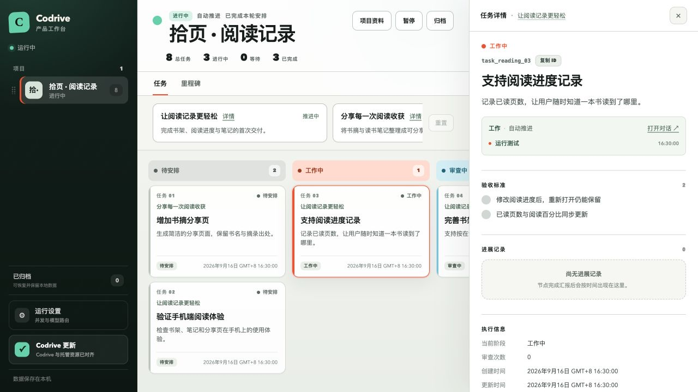

<div align="center">
  <h1>Codrive</h1>
  <p><strong>Automated task management for Codex App.</strong></p>

  <p>
    <a href="https://www.npmjs.com/package/codrive"></a>
    <a href="https://github.com/lzj960515/codrive/actions/workflows/ci.yml"></a>
    <a href="https://www.npmjs.com/package/codrive"></a>
    <a href="./LICENSE"></a>
  </p>

  <p><strong>English</strong> · <a href="./README.zh-CN.md">简体中文</a></p>
</div>

## What is Codrive?

Codrive is a local task manager for **Codex App**. It organizes agreed goals into milestones and tasks, coordinates execution, independent review, and acceptance, and displays progress on a board.

<p align="center">
  
</p>

## Why Codrive?

- **Automatic execution:** Turn goals into actionable tasks, order the work, and keep it moving.
- **Adaptive planning:** Update tasks and plans as new information emerges. You decide when the work needs to expand beyond its original scope.
- **Independent review:** Review each result separately and complete milestones only after they meet the acceptance criteria.
- **Visible progress:** Track progress on the board, revisit planning, execution, and review, and step in whenever a decision is needed.

## Get started

Requires **Node.js 24+, Git, and Codex App** with a working Codex login.

```bash
npm install --global codrive@latest
codrive setup
codrive
```

`setup` installs the bundled Skills and activity Hook. The terminal prints your board URL.

1. In Codex, run `/hooks` and review and trust the four Codrive activity Hook definitions.
2. Open your project in Codex App and describe your goal:

   > Use Codrive to plan and carry out this work. Confirm the scope and acceptance criteria with me before starting.

Continue in conversation to add work, adjust plans, check progress, or pause scheduling.

**Installing on a Mac mini:** give the AI on that machine the [Mac mini installation and acceptance guide](./docs/operations/mac-mini-install.md). It covers Codex readiness, installation, startup, Slack configuration, and verification. Slack support requires Codrive **0.15.0+**. If setup reports pending Hook review, review `/hooks` in Codex and rerun `codrive doctor`.

When a decision is needed, choose **Reply here** on the board to send your answer to the original conversation. The dialog closes after a successful send and execution continues. The adjacent conversation link remains available for the full context.

## Slack

Message the bot directly for general conversation, or bind a project channel and send ordinary messages without mentioning it. Each new channel message starts a conversation; replies stay in its thread. Ordinary requests are handled directly, while engineering work uses Codrive's existing development, independent review, and delivery workflow.

[Slack setup and Mac operation](./docs/operations/slack.md) covers the app manifest, private token configuration, project binding, and Codex-native scheduled reports. Scheduled inspections report observed facts first and register follow-up work with that message as the reply destination.

Open **Runtime settings → Slack** on the local board to enter the workspace ID, authorized member ID, Bot `xoxb-…` Token, and Socket Mode `xapp-…` Token. Enable Slack and save to connect. Tokens stay in the local `~/.codrive/config.json` with mode `0600`; they are never returned to the settings form or embedded in source. Blank token fields preserve saved values for the same workspace. The guide also provides private-file configuration for an AI installer.

Use `/new` to start a fresh direct-message conversation, `/models` to discover models, `/model` to switch, and `/state` to inspect a conversation. Direct messages use a dedicated working directory and receive separate local-workspace and Codrive-product catalogs. Project details show the bound Slack channel. Images and other files can be received and generated files sent back to the originating thread.

Starting with **0.16.0**, ask the bot to create a project channel, invite you, and bind it through the Slack API. The manifest includes `channels:manage` for public channels and `groups:write` for private channels; reinstall existing apps after adding these scopes. Project discovery checks saved local workspace names and real directories, while `/state` shows the current working directory.

## Everyday commands

| Command | Purpose |
| --- | --- |
| `codrive` | Start the local service |
| `codrive status` | Check service status |
| `codrive stop` / `codrive restart` | Stop or restart |
| `codrive upgrade` | Update to the latest version |
| `codrive doctor` | Check the environment and setup |

## Local operation

Codrive runs on your computer after installation and keeps its project and task records locally. AI requests use your configured Codex model service.

**Automatic tasks have full local access**, including file edits, commands, and Git operations without individual terminal approvals. Use trusted repositories and define the work's authorization boundaries.

## Development

Use Node.js 24+ and pnpm 11.5.1:

```bash
corepack enable
pnpm install
pnpm typecheck
pnpm test
pnpm build
pnpm dev
```

Read more: [Milestones and planning](./docs/architecture/milestones.md) · [Product facts](./docs/architecture/product-facts.md) · [Board synchronization](./docs/architecture/realtime-sync.md) · [Semantic Atlas integration](./docs/architecture/semantic-atlas-maintenance.md).

[MIT License](./LICENSE)
