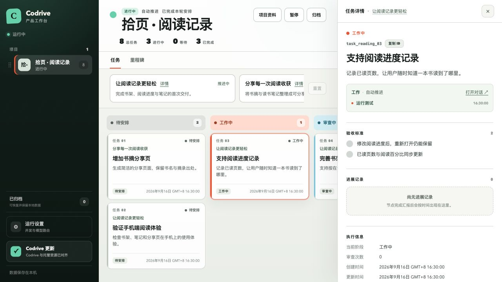

<div align="center">
  <h1>Codrive</h1>
  <p><strong>面向 Codex App 的自动任务管理工具。</strong></p>

  <p>
    <a href="https://www.npmjs.com/package/codrive"></a>
    <a href="https://github.com/lzj960515/codrive/actions/workflows/ci.yml"></a>
    <a href="https://www.npmjs.com/package/codrive"></a>
    <a href="./LICENSE"></a>
  </p>

  <p><a href="./README.md">English</a> · <strong>简体中文</strong></p>
</div>

## Codrive 是什么？

Codrive 是运行在本机的 **Codex App** 任务管理工具。它将已确认的目标组织成里程碑和任务，自动推进执行、独立审查与验收，并通过看板展示进度。

<p align="center">
  
</p>

## 为什么使用 Codrive？

- **自动推进：** 把目标拆成可执行的任务，安排好先后顺序并持续推进。
- **动态规划：** 执行中发现新情况时及时调整任务和计划；需要扩大工作范围时，由你决定。
- **独立审查：** 每项工作完成后都会单独审查，达到验收标准后才会完成里程碑。
- **过程可见：** 你可以通过看板掌握进度，随时查看规划、执行和审查过程，也可以直接参与决定。

## 开始使用

需要 **Node.js 24+、Git、Codex App**，并完成 Codex 登录。

```bash
npm install --global codrive@latest
codrive setup
codrive
```

`setup` 安装随包提供的 Skills 和活动 Hook，启动后终端会显示看板地址。

1. 在 Codex 中运行 `/hooks`，审核并信任四条 Codrive 活动 Hook 定义。
2. 用 Codex App 打开项目，说明你的目标：

   > 用 Codrive 规划并推进这项工作，开始前先和我确认范围与验收标准。

后续也可以直接通过对话追加任务、调整计划、查询进度或暂停调度。

**在 Mac mini 上安装：** 将[Mac mini 安装与验收说明](./docs/operations/mac-mini-install.md)交给那台机器上的 AI，即可按步骤安装、检查 Codex、启动服务和配置 Slack。Slack 功能需要 Codrive **0.15.0+**。如果 `setup` 提示 Hook 待审阅，先在 Codex 完成 `/hooks` 审阅，再运行 `codrive doctor` 核实。

需要你决定时，可以点击看板上的 **在此回复**，填写意见并发送到原对话。发送成功后弹窗关闭，任务继续执行；也可以使用旁边的对话入口查看完整上下文。

## Slack

直接私信机器人进行全局交流，或把项目绑定到频道后直接发普通消息，无需艾特。频道里每条新消息建立一个会话，机器人在它下面的讨论串回复。普通请求直接完成，工程工作沿现有开发、独立审查与交付流程推进。

[Slack 接入与 Mac 运行](./docs/operations/slack.md)说明应用配置、私有凭据、频道绑定和 Codex 原生定时报告。巡检先发送客观事实消息，再携带回复位置登记后续工作，原因调查交给开发阶段。

在看板打开 **运行设置 → Slack**，填写工作区 ID、授权成员 ID、机器人 `xoxb-…` Token 和 Socket Mode `xapp-…` Token，启用后保存并连接。Token 只保存在本机 `~/.codrive/config.json`（权限 `0600`），页面不回显，代码中没有真实 Token；同工作区留空会保留已保存的值。也可以让 AI 按安装文档通过私有文件配置。

Slack 命令：`/models` 查看模型列表，`/model` 切换模型，`/state` 查看会话状态。机器人支持接收图片、文档等附件，并将生成的文件发回原讨论串。

从 **0.16.0** 起，可以私信机器人创建项目频道、邀请本人并绑定，全程使用 Slack API。模板包含公开频道 `channels:manage` 和私有频道 `groups:write` 权限；已有应用补权限后重新授权。私信按本机保存的工作空间名称和真实目录识别目标，`/state` 可查看当前执行目录。

## 常用命令

| 命令 | 用途 |
| --- | --- |
| `codrive` | 启动本地服务 |
| `codrive status` | 查看服务状态 |
| `codrive stop` / `codrive restart` | 停止或重启 |
| `codrive upgrade` | 更新到最新版本 |
| `codrive doctor` | 检查环境与安装配置 |

## 本地运行

Codrive 安装后即可在本机使用，项目与任务记录保存在本机。AI 请求由你配置的 Codex 模型服务处理。

**自动任务拥有完整本机访问权限**，可以修改文件、执行命令和 Git 操作，无需逐次终端审批。请在可信仓库中使用，并明确工作的授权范围。

## 参与开发

使用 Node.js 24+ 和 pnpm 11.5.1：

```bash
corepack enable
pnpm install
pnpm typecheck
pnpm test
pnpm build
pnpm dev
```

进一步了解：[文档入口](./docs/README.md)，包含安装说明、架构、方案与实际验收记录。

[MIT 许可证](./LICENSE)
