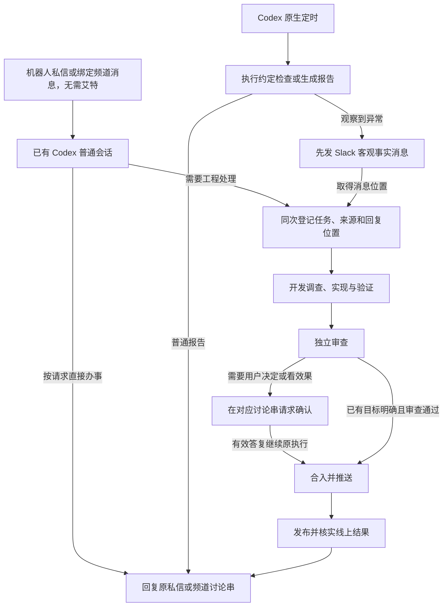
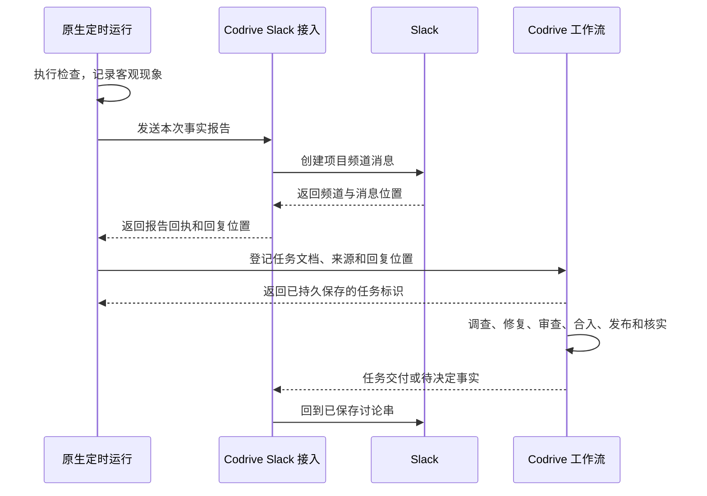

# Codrive 本地 Slack 助理规格

- 状态：已按用户确认实施；本地代码、替身验证及当前 Mac 的真实 Slack 会话、命令、报告和双向文件传输验收完成。另一台 Mac mini 与工程发布验收保留独立边界。
- 日期：2026-11-03；最后更新：2026-11-03。
- 文档职责：定义本次交付的需求、行为、流程、扩展边界与验收；后续实施和任务拆分以本文件为入口。
- 依据：[讨论与取舍](2026-11-03-slack-assistant.md)，用户对私信、频道免艾特与讨论串会话的纠正，以及审阅当前方案后的“OK，去实现吧”。
- 实现基线：Codrive `0.14.0`，本地提交 `6b1527e`；相关源码和参考资料列在文末。
- 本轮授权：实施当前规格及下文 D1—D6 的具体存储和约束清单；用户随后明确授权在现有工作区创建、安装和测试机器人，增加命令、头像及文件传输，并确认最终安装权限。不包含发布 Codrive 或创建原生定时计划。

## 一、问题与交付目标

用户希望在另一台 Mac mini 上运行 Codex 与 Codrive，从 Slack 查询数据、安排工作、接收报告和必要确认，离开桌面窗口后仍能获得结果。

普通查询和杂事由当前 Codex 直接完成；需要工程开发时才交给现有 Codrive。巡检像测试工程师一样记录客观现象，先发 Slack 消息，再登记工作，由开发阶段调查原因。明确 Bug 修复经过验证和独立审查后自主合入、发布、核实，最终回复原私信或频道讨论串。

交付继续使用现有 Codrive 项目和任务体系，部署一个 Codrive 服务。Codex 原生定时负责计划管理与触发，普通会话和定时提示词表达意图，首版复用现有 Skills。

### 1.1 已确认的需求基线

| 编号 | 需求 |
| --- | --- |
| B1 | 支持 Mac 本地运行，通过 Slack 双向交流及主动报告。 |
| B2 | 机器人一对一私信用于全局交流与项目绑定；已绑定频道用于对应项目。频道内直接发消息即可，每条根消息对应一个会话，机器人在其讨论串回复。 |
| B3 | 普通查询、分析、报告和杂事直接执行并回复，不创建开发任务或启动独立审查。 |
| B4 | 工程工作直接登记现有 Codrive，沿其工作、审查、合入与后续交付流程推进。 |
| B5 | 既有行为下的明确 Bug 自主核实、修复、验证、审查、合入、发布和线上核实，完成后汇报。 |
| B6 | 预期结果有业务分歧时请求决定；需要看效果时，审查与候选预览在前，人工确认后合入发布。 |
| B7 | 定时工作采用 Codex 原生管理与触发；本项目提供报告发送和工程工作登记能力。 |
| B8 | 巡检只执行约定检查，记录操作、预期、实际结果与直接证据；根因调查、原因假设和代码修改属于开发阶段。 |
| B9 | 巡检发现异常后，先向 Slack 发客观事实消息，取得位置后再登记工作；后续结果回到该讨论串。 |
| B10 | 消息和定时提示词表达工作意图；首版不新增日常交流、巡检或路由 Skill，不设置中枢分发 AI、Issue 面板或第二套任务体系。 |
| B11 | 在 Slack 使用命令切换模型；私信作用于全局默认，绑定频道作用于项目，当前回合保持不变。 |
| B12 | 使用状态命令或消息快捷操作查看明确会话的模型、推理强度、权限和 token 用量；指标取实际数据，上下文余量注明估算。 |
| B13 | 接收 Slack 图片与文件供 Codex 读取，并将生成的本机文件发回原会话；复用现有接入记录。 |
| B14 | 用户可在私信要求通过 Slack API 创建项目频道、邀请本人并绑定；按本机工作空间名称与真实目录识别目标，保持同目录不同产品的身份独立。 |

单台 Mac、一个 Slack 工作区、一个授权用户、机器人私信与已绑定项目频道作为首版实现范围。多项目是当前范围；多机器和团队权限体系留待后续需求。

### 1.2 术语

| 术语 | 本规格中的含义 |
| --- | --- |
| 普通会话 | 机器人一对一私信或项目频道讨论串与原生 Codex 会话的关联，直接承接用户输入；不是 Codrive 开发任务。私信不固定项目，频道讨论串保留所属项目。 |
| 工程工作 | 需要沿 Codrive 完成调查、修改、审查和交付的工作，使用现有 Task。 |
| 巡检 | 原生定时或人工要求的一次检查；取得观察事实，不诊断原因。 |
| 来源 | 工作由哪次 Slack 输入或本地 Codex 定时运行产生。 |
| 回复位置 | 报告和后续结果要送达的 Slack 工作区与对话位置：私信可直接回复，项目频道回复必须带根消息位置。来源与回复位置分别记录。 |
| 完成交付 | 满足本次工作约定的结果；需要上线时，包含发布成功和线上核实。 |

## 二、用户场景与验收条件

验收编号对应已经确认的行为。实现提案的补充验证另列于第七节，不因写入测试清单而自动成为已批准需求。

### U1：绑定项目与频道

作为用户，我希望直接私信机器人说明频道与项目的关系，以便在项目频道直接发消息办事。

- A1.1：用户私信机器人“把某频道绑定到某项目”等自然语言，使用已有项目与仓库事实完成绑定并回复；无需建立专门的全局管理频道。
- A1.2：项目存在歧义时列出可辨认的候选并请用户选择，未确定前不猜测仓库或发起开发。
- A1.3：授权用户在机器人已加入的绑定频道直接发文字即可，无需 `@`；支持已授予相应权限的公开及私有频道，不同频道分别落到对应项目。
- A1.4：普通项目接入本身不制造开发任务或虚假里程碑。具体轻量登记改动见第六节提案。
- A1.5：用户要求新建频道时，核实项目身份后使用 API 创建、邀请配置的本人并保存既有绑定；权限缺失时准确说明所需 scope，授权后继续 API 流程，创建动作不依赖本机屏幕。远端部分成功时保留真实频道 ID 供显式续办。
- A1.6：私信的全局执行目录与目标仓库分别表达；用户指定本机工作空间时，读取 Codex 保存目录并核实 README、AGENTS，再与 Codrive 产品事实对照。已有产品只与工作空间共享目录时，以现有空任务登记保存准确工作空间身份，原产品和暂停项目保持原样。

### U2：直接完成普通工作

作为用户，我希望查询数据、分析和整理资料能在当前会话直接完成，以便得到结果时不必等待开发流程。

- A2.1：“查昨天的访问量”等请求由当前 Codex 调用适用工具，结果回复原讨论串，开发任务数量不增加。
- A2.2：项目频道中，用户每条新的根消息创建一个会话，机器人以该消息为根回复；同一讨论串追问保留前文，另一条根消息的讨论串独立。机器人私信作为全局对话连续交流，默认不绑定项目。
- A2.3：用户不用选择工作模式，也不先调用一个新增的路由 Skill。
- A2.4：查询发现另一个需要工程处理的问题时，已有查询结果可先返回；工程处理作为后续工作登记，不阻塞原结果交付。

### U3：委派明确故障并自主交付

作为用户，我希望把故障现象交给 AI 后，它能核实、修复并上线，只在必要时向我请求决定。

- A3.1：用现有 `codrive-work` 写好任务文档并登记工作，任务目标、观察事实和既有行为可供执行者读取。
- A3.2：任务与来源、回复位置在同次登记中保存，保存完成后才进入调度；不是先启动再补地址。
- A3.3：开发阶段核实原因；确认是真实 Bug、预期明确且授权覆盖时，自主完成验证、审查、合入、推送、发布和线上核实。
- A3.4：没有新增业务取舍时不设置固定的修复前或发布前审批。项目既有数据、权限和业务确认规则继续适用。
- A3.5：如果现象不构成 Bug，说明调查事实和结论，沿现有任务生命周期结束或请求必要决定，不制造无意义修改。
- A3.6：最终通知回到登记时保存的私信或频道讨论串，区分已合入、已发布、已在线上核实；没有证据时不宣称“已修复上线”。

### U4：在必要时决定或看效果

作为用户，我希望 AI 带着具体问题或可查看的候选来找我，以便一次回答后继续交付。

- A4.1：目标存在业务分歧时，问题说明观察事实、选择及影响，沿现有 `needs_input` 保留现场。
- A4.2：需要看效果时，先开发、自测、独立代码审查、推送候选并提供可查看预览；确认前不合入或发布该候选。
- A4.3：远处使用 Slack 的用户能按提供的方式查看结果；Mac mini 的 `localhost` 地址本身不构成可用预览。
- A4.4：有效答复通过 `decision.reply` 继续当前问题对应的原执行。普通补充不被无条件当作正式决定。
- A4.5：重复或已过期答复不重复续跑，也不回答另一个新问题；保留已有问题和候选。
- A4.6：人工确认后发生实质改动时，重新判断受影响的验证和验收；不能把旧确认用来放行新的实质结果。

### U5：接收原生定时报告

作为用户，我希望沿用 Codex 的定时管理，并在项目 Slack 频道收到结果，以便集中查看。

- A5.1：时间、频率和执行计划由 Codex 原生能力保存并触发，Codrive 不保存第二份周期定义或运行另一套定时器。
- A5.2：定时提示词直接表达检查或报告要求，调用已有能力完成；报告发送到绑定项目的 Slack 频道。
- A5.3：普通报告不创建开发任务。要求每日报告时按要求发送，要求异常时通知时按该要求执行。
- A5.4：找不到项目或绑定频道时明确说明配置缺口，不把报告发往猜测的其他项目。

### U6：巡检只报事实，后续工作交给开发

作为用户，我希望巡检报告客观问题并登记工作，以便开发者独立调查，不被巡检猜测带偏。

- A6.1：巡检只执行本次约定的检查，记录已观察到的操作、预期、实际结果及已有直接证据。
- A6.2：报告不附加“可能是某服务、缓存或数据库有问题”等未经调查的原因，也不为解释现象追加源码、日志或数据库排查。
- A6.3：发现异常后先发 Slack 事实消息，成功取得消息回执后再调用 `codrive-work` 登记，并携带该回复位置。
- A6.4：可登记“调查登录失败并恢复既有登录能力”，无需先证明具体缺陷或给出修复方案。根因核实、修复和交付由开发链路完成。
- A6.5：发消息失败时不声称已经完成登记；消息已成功但登记失败时保留消息，重试使用该位置，不重新发送已成功的事实报告。
- A6.6：发送成功不等于登记成功，登记成功不等于修复上线；每一步以实际回执和交付证据确认。

## 三、流程与不变量

图表示用户可观察的交付顺序；实际仍沿现有任务状态机。业务目标不清时可以在任何需要决定的阶段等待，不能因图中位置而先开发后补产品决定。

必须保持以下关系：

1. 私信承担全局交流，频道按项目关联；普通会话与任务调度会话各有职责，聊天不写入 `planningThreadId`，不另设主频道。
2. 频道决定新会话的项目；已建立会话和已登记任务使用保存的项目、来源与回复位置，之后改绑不搬走旧工作。
3. 定时来源仍是本地 Codex 定时运行，Slack 是其报告目的地；不把两者压成一个 `fromSlack` 布尔值。
4. 只有当前有效问题才能续跑 `decision.reply`；消息收件身份不替代问题身份。
5. 任务活动与交付证据继续是业务结果的来源，Slack 发送状态不复制开发状态。
6. 任务报告保持当前阶段最后一个副作用；报告后的 Slack 通知由服务负责，发送失败不撤销开发结果或触发再次发布。

## 四、现有能力复用与模块改动

以下为推荐实现边界；不新增 `release` 任务动作、不替换 Codex 接入、不建立平行工作流。

| 所有者 | 复用基础 | 本次必要改动 |
| --- | --- | --- |
| Slack 接入与显示 | Pietra AI API 的 Socket Mode、线程定位、流式卡片、Markdown 与表格转换 | 在 Codrive 中提取单用户接入；调整授权用户在绑定频道直接发消息的订阅和过滤；适配 Codex 公开事件 |
| 普通会话转接 | `CodexGateway` 的创建、恢复、命名、回合与通知 | 保存讨论串关联，将用户原始输入交给 Codex；串行接收同一会话的后续输入，回复原处，不先调用路由模型 |
| 项目与配置 | 现有 Project、仓库归属与私有 ConfigStore | 在私信中绑定和查询频道；普通项目仅登记的入口提案；私信操作仓库时明确取得目标，不默认猜选仓库，也不配置主频道 |
| 工作登记 | 现有 `project.add_work`、任务文档校验和立即调度 | 同次保存来源和回复位置，提供可回读的任务来源；已有无来源任务继续按原行为执行 |
| 任务交付 | 现有 `work/review/integrate`、`work_required` 与无代码结果 | 需要预览时合入前等待；合入后继续发布和线上核实，实际交付后才结束任务 |
| 决定与通知 | 现有 `decision.reply`、事件订阅和活动历史 | 将当前决定、确定阻塞和交付结果投递对应讨论串；发送失败独立记录和重试 |
| 原生定时接入 | Codex 本地计划和现有 Skills | 提供可调用的报告与工作登记命令；计划仍在 Codex 管理 |
| 本地运行 | 现有 CLI、启动、停止、升级和诊断 | 补齐 Slack 配置与常驻说明，保证一个服务生命周期所有者，不让外部自动重启与 stop/upgrade 冲突 |

### 4.1 普通会话与工作接续

Codex 的创建与恢复会话接口需要工作目录。机器人私信使用本机已有的 Codrive `stateDirectory` 启动全局会话，不将该目录登记成产品，`projectId` 缺省；列项目、绑定频道等操作通过现有命令明确指定目标。项目频道会话使用对应 `Project.repositoryPath` 作为工作目录，并保存项目归属。私信需要操作仓库时显式取得目标项目，不通过默认目录猜测目标。

私信默认按一对一对话持续使用同一个普通 Codex 会话，用户可在其中谈不同项目。项目频道按 `event.thread_ts ?? event.ts` 取得根消息位置，以工作区、频道和根消息作为会话身份：新的顶层消息创建新会话，机器人发送时设置 `thread_ts` 指向该用户根消息；用户在讨论串中的追问进入同一个会话。普通回复不广播为频道顶层消息。

只有需要工程处理时才产生一个或多个现有任务。任务工作与审查仍使用原有独立会话。用户问进展或补充事实时，当前普通会话可读取关联工作并按意图调用已有能力，不能仅因任务进入 Review 就把所有新消息送给审查者。

同一回合仍在运行时，收到补充先确认收件，再在可接收的回合边界处理。现有网关尚未封装 `turn/steer`，首版不以即时插入为前提。会话被桌面应用占用时说明实际冲突并保留输入，不假定两个入口能同时写入。

### 4.2 发布与预览的所有权

代码工作仍在任务工作树中完成，Git、冲突处理和发布动作由执行者按项目约定进行。预览与发布优先调用仓库已有 Skill、脚本或 CI，不建立通用发布平台。

`integrate` 合入后仍需发布时返回 `work_required`；后续 `work` 执行发布并收集证据，现有非代码 Review 与 Integrate 核实该成果。完成条件包含线上结果时，不能在仅合入或仅推送后将整个任务标为完成。

接入项目需要已有或补齐可核实的检查命令、候选查看方式、发布入口、目标环境和线上结果验证方式。缺少事实时保留明确阻塞，不虚构预览地址或发布成功。上线失败从已完成现场继续，回滚沿项目已有运行契约判断。

### 4.3 Slack 显示与结果发送

参考 AI API 的 `@slack/bolt` Socket Mode、`event.thread_ts ?? event.ts`、原生流式进度卡片及 Markdown/table blocks。普通结果、原生报告和开发通知共用确定性发送能力。展示公开进展与结果，具体映射以 Codex 已提供事件为准。

AI API 当前频道入口主要接收 `app_mention`，普通 `message` 限于 DM；本次通过普通频道消息订阅移除这一接入限制。原有店铺、多租户 OAuth、Redis、VoltAgent 与业务附件流程不搬入单用户服务。既有显示机制的接入通过实际 Slack 检查验证。

### 4.4 免艾特接收的订阅与权限

Slack 官方消息事件允许直接接收普通消息，不需要消息中包含机器人提及。机器人先加入目标频道，再启用对应 Bot 事件及权限：

| 对话位置 | 事件订阅 | 对应 Bot 权限 |
| --- | --- | --- |
| 一对一机器人私信 | `message.im` | `im:history` |
| 公开项目频道 | `message.channels` | `channels:history` |
| 私有项目频道 | `message.groups` | `groups:history` |

发送回复使用 `chat:write`，Socket Mode 的 app-level token 使用 `connections:write`。绑定时使用 `conversations.info` 核实频道，使用 `conversations.list` 列出可选频道，manifest 包含 `channels:read`、`groups:read`；机器人仍需先加入目标频道。命令和下拉交互使用 `commands` 与 `interactivity`，文件传输使用 `files:read`、`files:write`。新增权限后，应用需要重新安装或授权使其生效。

应用 manifest 开启 App Home 的 Messages 页（`features.app_home.messages_tab_enabled: true`），允许用户在其中发送消息（`messages_tab_read_only_enabled: false`），使机器人私信入口实际可输入；不要求用户另建管理频道。

Bolt 使用 `message` 入口，根据已配置工作区、授权用户和对话位置处理私信或已绑定频道；排除机器人自身输出及不代表新用户请求的编辑、删除等事件。免艾特不依赖 `app_mention`，不将同一条被提及消息同时当作两份输入。

频道回复用 `thread_ts = event.thread_ts ?? event.ts`；私信直接回复该一对一对话，用户在私信已有讨论串内发消息时尊重其回复位置。事件重投和机器人输出不会创建重复会话或相同工作。

以上为官方协议核实结果，实际应用安装、私有频道成员关系、订阅与收发仍须按第七节实机检查。

## 五、现有 Skill 扩展与调用契约

首版新增 Skill 数量为零。意图来自用户消息或定时提示词，下面的能力沿现有 Skill 入口扩展；底层收发、关联与持久化由程序实现。

| 现有 Skill | 规格要求 |
| --- | --- |
| `codrive-control` | 增加项目绑定、查询和报告发送能力，回执能提供项目、工作区、频道与讨论串位置；继续承担现有控制与状态查询。 |
| `codrive-work` | 沿当前任务文档流程登记工作，支持来源与回复位置同次登记；接受客观故障目标，根因未知不妨碍登记，不要求巡检先完成诊断。 |
| `codrive-task` | 在开发阶段核实原因并执行交付；保留原有审查、返工、合入与报告契约，补齐按需预览和上线核实边界。 |
| `codrive-forge` | 复用产品事实与项目登记；支持只登记项目而不发起开发，不新增专门登记 Skill。 |

命令沿现有本机鉴权的 `/api/commands` 提供。新增 `slack.configure`、`slack.bind`、`slack.report`、`slack.send_file`；连接状态与频道查询分别为 `GET /api/slack`、`GET /api/slack/channels`。登记工作沿用 `project.add_work`，回复决定沿用 `decision.reply`，脚本用法见[运行说明](../operations/slack.md)。

Slack 的 `/models` 只读列出当前作用范围可切换的主模型，并标明当前、备用模型；`/model` 直接使用模型目录及既有全局/项目设置，保留备用模型与仍适用的推理强度。`/state` 在私信查看唯一会话；频道命令没有讨论串身份，因此让用户选择已有会话。消息快捷操作「查看 Codrive 状态」使用选中消息的根位置精确定位。权限和 token 数据仅作进程内观察，不增加持久字段；没有事件数据时显示暂无，上下文余量有依据时注明估算。

附件在授权、绑定与事件去重后下载到本机 `slack/files/`。保存收件记录前剥离瞬时附件元信息，将文件名、类型与本机路径写入既有消息文本，重启沿原文本继续；文件内容是用户资料，不建立独立附件任务。发送文件通过官方 `filesUploadV2` 返回真实文件身份和可用链接，沿原 `replyTarget` 发回；首版不新增文件自动补送回执。

| 能力 | 必要输入 | 成功回执与限制 |
| --- | --- | --- |
| 绑定频道 | 已登记项目、目标频道；工作区与授权身份由接入配置校验 | 返回实际绑定的项目与频道；歧义先澄清，不创建开发目标。 |
| 发送报告 | 项目、一次发送请求的稳定身份、正文、来源 | 在项目绑定频道建立事实消息，返回真实发送状态和回复位置；原生巡检只有取得位置后才登记工作。已有 Slack 会话直接保留输入位置。 |
| 登记工作 | 沿用任务文档路径和决定摘要，附来源与回复位置 | 返回实际接受的任务标识和保存的来源；同一请求重试查回已有结果。 |
| 回复当前决定 | 沿用 `scope`、对象 ID、`reportOpportunityId`、答复文字 | 当前问题有效才继续原执行；不以讨论串最新文字替代问题身份校验。 |

一次发送或登记请求的身份由入口或调用脚本生成并在同一次操作重试时复用，不要求用户手填。Slack 事件使用其实际事件身份；原生定时报告使用本地生成的报告请求身份，不依赖尚未核实的原生计划或运行 ID API。

报告内容以普通文字或 Markdown 表达即可，不要求用户按专门表单编写。巡检事实进入任务文档时保持原意，原因分析和修复结论由后续开发补充。

## 六、已确认的数据变更

本节 D1—D6 已随当前完整方案呈现给用户，用户随后明确要求“OK，去实现吧”，本轮按该具体清单实施。新增结构都位于既有本机配置、项目状态或 Slack 接入记录中，继续复用文件存储，没有新增数据库或外部队列。

### 6.1 选择依据

现有 Project 已保存仓库和产品事实，Task 已保存工作与执行状态，原生 Codex 已保存模型对话。完整复用这些来源即可，不再复制项目目录、会话全文或开发状态。

仅使用 `events.data`、任务描述或一份提示词保存 Slack 地址不足以支持可靠回读、旧任务兼容和按当前问题答复。连接与绑定保存在本机配置，讨论串关联和消息回执保存在独立的 Slack 接入记录中，任务只新增可选的来源与回复位置。

| 已确认变更 | 具体字段或约束 | 必要性、复用比较与使用方 |
| --- | --- | --- |
| D1：扩展 `CodriveConfig.slack?` | `enabled`、`teamId`、`authorizedUserId`、`botToken`、`appToken`；启用时检查完整性；不新增主频道字段 | 复用现有 `ConfigStore` 私有文件和 `0600` 权限，不新增凭据平台。影响启动、设置校验、Socket 连接、诊断和公开设置投影；Token 只在本机读取，不能进入公开响应、日志、任务文档或消息。未配置时保持 Slack 关闭。 |
| D2：配置中的 `slack.projectBindings` | 每项 `projectId`、`channelId`；工作区来自 D1。每频道关联一个项目，首版每项目有一个主动报告频道 | 项目仓库继续取 `Project.repositoryPath`；绑定只保存 ID，避免另一份项目事实。影响绑定命令、普通会话、原生报告和项目查询。绑定关系变化只影响之后创建的主题和报告。 |
| D3：`SlackConversation` 本地记录 | `conversationType: direct_message \| channel_thread`、`teamId`、`channelId`、`threadTs?`、`codexThreadId`、`projectId?`、`createdAt`、`updatedAt`；私信以工作区和一对一对话 ID 关联全局会话，频道以工作区、频道及必需的根消息关联项目会话 | Task 的工作和审查会话不承担普通聊天，`planningThreadId` 也不能复用。私信没有固定项目；频道主题保存建立时的项目身份。影响输入转接、后续交流和重启后续接；正文历史仍由 Codex 保存。 |
| D4：Task 及 `CreateTaskInput` 的可选通信字段 | `source?: { kind: 'slack' \| 'codex_native', requestId: string }`；`replyTarget?: { kind: 'slack', teamId: string, channelId: string, threadTs?: string }`。外部工作两项成对登记，项目频道的 `threadTs` 必填，直接私信可缺省 | 来源说明触发身份，回复位置冻结本次交付目的地；不同生命周期不混成一个标记。当前 `TaskOrigin` 仅服务 Semantic Atlas，保留其语义。影响任务输入校验、存储、上下文、详情和通知。已有任务两项都缺省，继续原行为。 |
| D5：Slack 收件、报告及通知回执 | 收件记录保存实际 `eventId`、来源位置、用户输入、接收时间及已派发会话/回合身份；报告发送记录保存 `requestId`、项目、正文、目标、成功后的消息位置；任务通知保存源活动或事件身份、目标、正文、发送结果和错误 | 这是接入层传递记录，不是 Issue 或开发状态机。它让重复事件回到同一会话/登记结果、原生报告重试沿用已发消息、结果发送失败不重做业务。影响输入排队、发送、重启恢复与诊断。 |
| D6：项目登记输入约束调整 | 允许 `tasks: []` 且没有初始里程碑；保留非空产品事实、仓库、默认分支和当前 Project 类型 | 现有 HTTP 要求任务或里程碑，但底层能保存空项目并进入 `idle`。放宽入口即可满足普通项目先登记与绑定，避免平行项目模型。影响 `project.register`、登记 Skill 和输入验证；以后追加工作沿现有入口唤起调度。 |

实现遵循本清单；未来改变字段含义、持久结构或约束时按实际差异重新确认。`SlackStateStore` 在本机状态目录的 `slack/` 下分别保存会话关联、输入和发送回执，采用原子写入及 `0600` 权限。无需为本次能力重写现有 Project、Task 或任务阶段。

### 6.2 消息回执与决定身份

D5 的收件记录负责“这条输入已接收、交给了哪个会话”，发送记录负责“这份结果送到了哪里”。原生报告发送成功后返回同一 `requestId` 和真实 Slack 消息位置，登记工作继续复用它们。普通查询没有工程结果时，记录中也不需要任务。

待决定通知在发送记录中关联现有 `DecisionReplyTarget`：`scope`、对象 `id`、`reportOpportunityId`。普通回复与有效决定的区别取自当前工作流事实；同一个讨论串里存在多个未决问题时明确指向所答问题，不猜测。

任务级问题回到任务保存的位置。私信任务既可直接回答，也可在已送达的问题下开串回答；其他讨论串不自动关联。项目或里程碑级问题沿现有决定契约，以所属项目绑定频道建立可回复消息并保存问题身份，不硬套成某个任务的问题。`SlackNotifications` 读取现有决定投影并再次核实当前身份后提供可答复问题。

收件和发送只记录必要的传递进展，不再保存一套工作优先级、开发阶段、修复结论或发布状态。任务结果和有效问题仍由现有工作流决定。

### 6.3 兼容、迁移与恢复边界

- 当前配置版本为 `2`，项目持久状态版本为 `5`，两者分别按现有升级入口处理，不能混作一个版本。
- 旧配置没有 Slack 时保持关闭；旧项目没有绑定；旧任务没有来源或回复目标时不自动补造、不发送历史完成通知。
- 新字段的读写、命令校验、状态校验、上下文和详情投影一起调整，保持保存后可重新读取。使用现有备份和迁移责任，不手改用户状态文件。
- 来源与回复位置在同一任务登记命令中保存，再允许调度；消息已发送但登记未完成的现场可以重新使用，不重新产生事实消息。
- 重启后回读已保存会话、回合和发送结果。是否已经执行过某个副作用不清楚时保留明确状态，不把未知结果当成成功或自动重新发布。
- 切换工作区后，旧工作区的输入和发送回执保持原样；新凭据不会发送旧工作区结果，也不会将旧报告回执当作新工作区成功。
- 首版不自动清理仍被任务、会话或待决定消息引用的接入记录，避免丢失来源。具体归档策略留待有实际容量证据时决定。

## 七、验证方式与交付检查

### 7.1 验证原则

测试证明用户结果、来源归属、问题身份与交付边界；不以提示词包含某句话、内部函数调用次数或框架装配通过代替行为验收。

自动化测试的外部边界为 Slack 事件与发送 API、本机命令、工作流的任务/活动结果、文件存储重新加载，以及原生 Codex 的公开会话事件。Slack、Codex 等外部依赖可替身化，生产依赖保持原有运行责任。

巡检和工作意图通过真实场景预演或有可观察结果的评测验证：约定检查返回失败时，输出中有事实、没有原因推断，未执行额外诊断或修改；观察到现象后调用的是报告与既有工作登记。普通查报告不得产生开发任务。

### 7.2 核心验收矩阵

| 验证场景 | 可观察结果 | 对应验收 |
| --- | --- | --- |
| 公开和私有项目频道分别发送未艾特的查询 | 机器人已入频道并有对应权限时接收普通消息，使用正确项目，只在各自根消息下回复，开发任务数量不变 | A1.3、A2.1 |
| 项目名称有歧义或尚无报告绑定 | 澄清或返回具体配置缺口，没有猜测仓库、投递到其他项目或发起开发 | A1.1、A1.2、A5.4 |
| 频道新根消息与讨论串追问 | 根消息创建独立会话，机器人回复只在该讨论串；追问保留同串上下文 | A2.2、A2.3 |
| 用户直接私信机器人 | 可连续交流、查询整体情况、绑定频道，不要求建立管理频道或先选项目 | A1.1、A2.2 |
| 普通查询同时观察到另一个工程问题 | 查询结果先返回，后续工程工作沿已有登记能力继续 | A2.4 |
| Slack 事件重复投递 | 返回同一受理/派发结果，不启动第二份相同工作 | A2.2、A3.2；D5 |
| 巡检观察到登录失败 | 先有客观事实消息，再有携带该消息位置的任务；巡检没有诊断原因或改代码 | A6.1—A6.4 |
| 发消息失败，或发成功但登记失败 | 分别保留未完成步骤；已有消息被复用，状态没有被虚报 | A6.5、A6.6 |
| 新任务保存时立即可调度 | 第一次派发之前，来源和回复位置已经可回读 | A3.2 |
| 明确 Bug 完成自动交付 | 有调查、验证、审查、合入、发布及线上核实证据，原串收到最终结果 | A3.3—A3.6 |
| 开发调查证明现象不是 Bug | 有事实结论，没有无意义代码修改，任务沿当前生命周期结束或请求必要决定 | A3.5 |
| 需要看效果的改动 | 确认前没有合入或发布，有效答复后原执行继续 | A4.1—A4.4 |
| 人工确认后的候选又有实质改动 | 重新检查受影响的验证与人工验收，不沿旧确认直接放行新结果 | A4.6 |
| 回复已过期或重复的问题 | 不重复执行、不回答新问题，保留当前有效现场 | A4.5 |
| 完成通知发送失败 | 开发结果保持不变，后续只补送通知，不重做修复或发布 | A3.6；第三节不变量 |
| 开发途中频道改绑，随后完成 | 已有工作仍回原来保存的位置，新主题使用新绑定 | 第三节不变量；D2—D4 |
| 原生定时输出普通报告 | 项目频道收到报告，本地没有新增周期定义或开发任务 | A5.1—A5.3 |
| 空项目登记、旧配置和旧任务加载 | 仅登记项目不发起开发；旧数据保持无 Slack 的既有行为 | A1.4；D1、D4、D6 |

跨项目隔离、重复决定和来源冻结属于用户结果，不是“配置透传”测试。框架连接、事件订阅、装配与格式能力通过源码核对、构建及真实 Slack 运行检查完成，不增加框架默认行为测试。

### 7.3 既有测试证据与执行命令

优先沿以下现有业务边界扩展测试，而不是为本次功能重造测试专用生产接口：

- [决定答复测试](../../test/application/decision-reply.test.ts)：重复答复只续跑一次，旧报告身份不能占用新的问题。
- [工作流测试](../../test/application/workflow-engine.test.ts)：合入后继续工作，无代码成果不复用旧代码候选，结果核实后才完成。
- [项目存储测试](../../test/infrastructure/project-store.test.ts)：任务文档读取、路径与正文的真实约束。
- [任务生命周期测试](../../test/domain/task-lifecycle-v4.test.ts)：开发、审查返工、合入和发布核实沿同一任务继续。

新增业务回归覆盖普通会话、来源登记、发送恢复、通知、工作区隔离及配置更新。完整链路使用真实 HTTP 入口、文件存储和工作流，以及 Slack/Codex 外部替身，验证普通查询、报告先行、来源登记、预览确认、合入后继续发布工作及原讨论串最终通知。本地检查使用 `pnpm test`、`pnpm typecheck` 和 `pnpm build`；最终结果见[实施记录](../changes/2026-11-03-slack-assistant-implementation.md)。替身结果不证明真实 Slack 收发、模型行为、实际发布或线上结果。

### 7.4 实机交付检查

试点 Mac mini 安装现有 Codrive、Codex 登录、管理的 Skills/Hook 和自己的 Slack 应用，配置本地凭据，验证机器人私信，并接通已邀请机器人的两个项目频道。机器保持登录、唤醒、联网，Codex 桌面应用和 Codrive 均运行。

实际验证直接私信、频道免艾特查询与讨论串追问、一次巡检事实报告与工作登记、一次明确 Bug 自主交付，以及一次候选预览后确认的完整路径。定时计划在 Codex 创建和管理；Slack 运行中能看到原生卡片、报告表格和回到对应私信或讨论串的结果。重启 Codrive 后验证会话关联和未送达结果的实际恢复范围。

每个接入仓库分别记录本地实现、合入、推送、发布和线上核实结果。完成通知和验收记录使用实际证据；某个边界未完成时如实保留，不能用其他边界成功推断。

## 八、未纳入首版的内容

- 自研定时管理、重复保存原生计划、自动补跑历史巡检，或直接改写 Codex 的内部定时文件。
- 新的日常交流、巡检和路由 Skill；额外中枢分发 AI、Issue 面板和另一套开发状态机。
- 多机器、多用户、多工作区、其他操作系统和复杂团队权限体系。
- 全新发布平台、自建 CI、逐任务虚拟机、通用回滚与强制隔离的审查环境。
- 巡检额外调查根因、提出原因猜测、直接修改代码或自行交付。
- 把所有普通查询或报告强制转成任务、独立审查，或者要求逐项配置自动修复白名单。
- 没有事实依据的兼容范围、数据回填、自动清理策略及全项目无边界自我迭代。

## 九、实施状态与后续边界

| 事项 | 当前状态 | 收敛所需依据或动作 |
| --- | --- | --- |
| D1—D6 具体存储与约束 | 已随完整方案取得用户实施确认并落实 | 后续超出清单的结构与含义变化，另按实际差异确认。 |
| 连续审查三轮上限 | 仍为代理建议，未作为硬性验收 | 结合真实返工样本判断次数与连续交付计数；若采用，耗尽后请求决定，不能自动放行缺陷。 |
| 试点项目预览与发布方式 | 需要项目事实 | 从真实仓库查证现有脚本、流水线、访问方式和线上核实方法，只有剩余业务选择请求用户决定。 |
| 登录后常驻的具体安装方式 | 沿用既有 CLI 后台服务 | 安装与运行说明已补齐；额外 `launchd` 守护及 Mac mini 实机验收留待目标机器接入。 |
| 从 Slack 管理原生定时计划 | 尚无受支持接入证据，不纳入首版 | 当前在 Codex 管理；未来有正式可用接口或明确新需求时再判断。 |

普通会话和绑定、来源完整的工程交付、原生报告入口均已实现。当前 Mac 的真实 Slack 验收已验证私信连续、频道免艾特与讨论串归属、独立根会话、模型发现与切换、状态、图片及 CSV 输入、结果文件回传和真实报告回执。Slack 拒绝注册 `/status`，当前短命令为 `/models`、`/model`、`/state`。网页设置已补齐凭据输入与连接状态；正式版本以 npm 和 Release 工作流记录为准。另一台 Mac mini、原生定时触发及各项目工程发布继续按对应实际环境验收。

## 十、证据与阅读入口

| 主题 | 可复核来源 |
| --- | --- |
| 用户决定与方案取舍 | [讨论记录](2026-11-03-slack-assistant.md) |
| 私有配置、配置版本与原子保存 | [ConfigStore](../../src/infrastructure/config-store.ts) |
| 项目状态版本与存储 | [state-schema.ts](../../src/infrastructure/state-schema.ts)、[ProjectStore](../../src/infrastructure/project-store.ts) |
| 当前领域类型、命令约束与任务来源 | [types.ts](../../src/domain/types.ts)、[command-schemas.ts](../../src/interfaces/http/command-schemas.ts) |
| 登记后立即调度、持续工作与完成 | [WorkflowEngine](../../src/application/workflow-engine.ts)、[workflow.ts](../../src/domain/workflow.ts) |
| Codex 会话与转接能力 | [CodexGateway](../../src/application/codex-gateway.ts)、[App Server 客户端](../../src/infrastructure/codex-app-server-client.ts)、[JSON-RPC](../../src/infrastructure/json-rpc-connection.ts) |
| 决定与恢复 | [decision-reply.ts](../../src/domain/decision-reply.ts)、[RecoveryManager](../../src/application/recovery-manager.ts) |
| 原有 Skill 契约 | [Control](../../skills/codrive-control/SKILL.md)、[Work](../../skills/codrive-work/SKILL.md)、[Task](../../skills/codrive-task/SKILL.md)、[Forge](../../skills/codrive-forge/SKILL.md) |
| AI API Socket 与线程 | [slack-handler.service.ts](../../../pietra-ai-api/src/agent/slack-config/slack-handler.service.ts) |
| AI API 进度卡片与格式 | [thinking-indicator.ts](../../../pietra-ai-api/src/agent/slack-config/thinking-indicator.ts)、[slack-formatting.ts](../../../pietra-ai-api/libs/slack/src/slack-formatting.ts)、[slack.service.ts](../../../pietra-ai-api/libs/slack/src/slack.service.ts) |
| 原生定时运行前提与 Skills | [OpenAI 官方定时文档](https://learn.chatgpt.com/docs/automations)，已于本轮讨论读取；未来实施按当时版本核实 |
| 普通私信与频道消息 | [message.im](https://docs.slack.dev/reference/events/message.im/)、[message.channels](https://docs.slack.dev/reference/events/message.channels/)、[message.groups](https://docs.slack.dev/reference/events/message.groups/)，2026-11-03 核实事件与权限 |
| 私信界面输入设置 | [Slack App manifest](https://docs.slack.dev/reference/app-manifest/)，2026-11-03 核实 Messages 页与可输入设置 |
| 频道成员与讨论串回复 | [Events API](https://docs.slack.dev/apis/events-api/)、[chat.postMessage](https://docs.slack.dev/reference/methods/chat.postMessage/)、[apps.connections.open](https://docs.slack.dev/reference/methods/apps.connections.open/)，2026-11-03 核实成员可见性、`thread_ts` 与连接权限 |
| 接入框架与 Slack 协议 | [App Server](https://developers.openai.com/codex/app-server/)、[Slack Socket Mode](https://docs.slack.dev/apis/events-api/using-socket-mode/)、[HarnessAgent](https://ai-sdk.dev/docs/ai-sdk-harnesses/harness-agent)，既有讨论中的读取依据 |

当前本地实现与已验证边界以实施记录为准；外部服务运行结果单独记录。在线文档不替代 Codrive 所锁定版本的协议核实。
