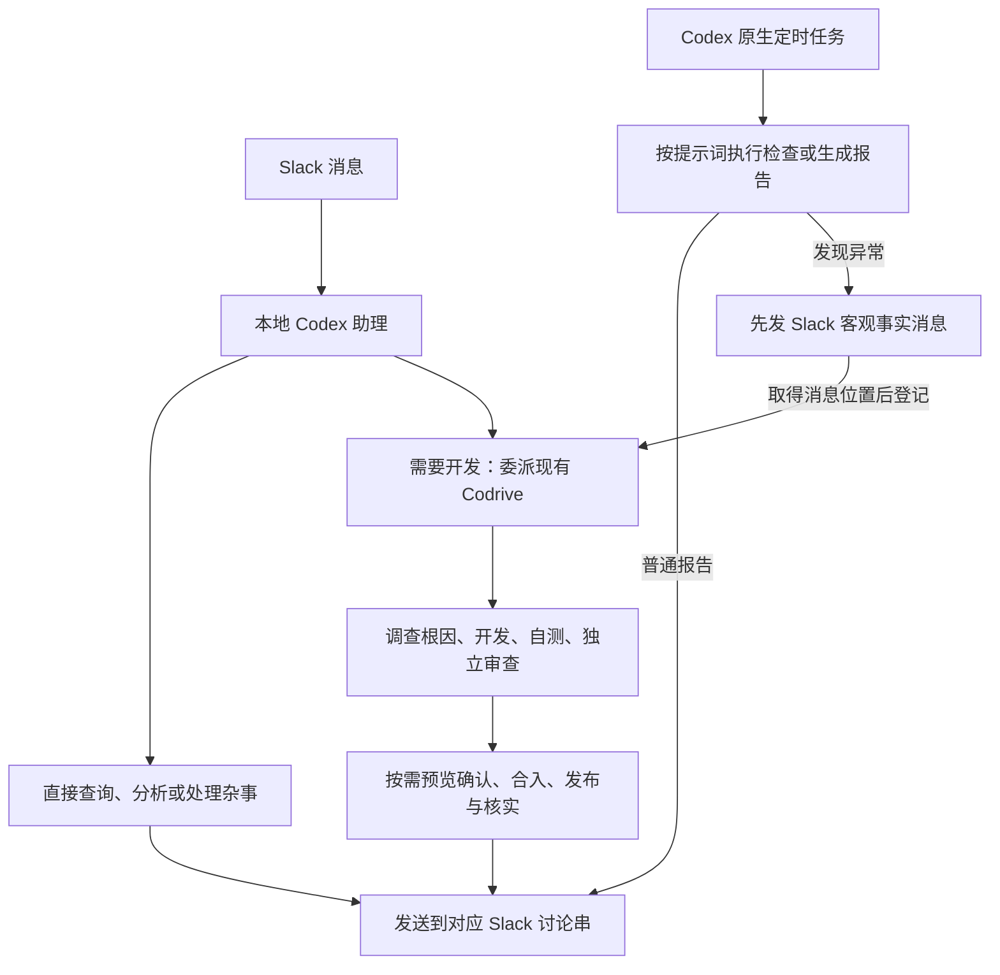

# Codrive 本地 AI 助理与 Slack 接入方案

- 状态：交付契约已转入[规格](2026-11-03-slack-assistant-spec.md)。本文件保留形成方案时的原始讨论和提案；用户随后确认实施，当前结果见规格及[实施记录](../changes/2026-11-03-slack-assistant-implementation.md)。
- 日期：2026-11-03；最后更新：2026-11-03。
- 范围：在现有 Codrive 上增加面向个人 Mac 的 Slack 助理入口，按需要委派开发工作。
- 文档职责：保留形成方案的讨论与依据；需求、流程、验收和后续任务拆分以[规格](2026-11-03-slack-assistant-spec.md)为入口。
- 当前说明：Slack 助理、报告入口及按来源回报已在本地实现，原生定时能力由 Codex 提供；接入方式见[运行说明](../operations/slack.md)。下文的调查结论按讨论时点保留。
- 授权边界：讨论阶段只调查和修订文档；后续“OK，去实现吧”确认当前规格及 D1—D6。真实 Slack 安装、消息发送和 Codrive 发布尚未执行。

## 一、用户要的是一个能办事的助理

用户在 Slack 项目频道说“帮我看一下昨天的数据”，助理查询数据，说明结论，直接回复。用户在 Codex 安排“每天早上帮我看看服务情况”，原生定时运行到点查看并将结果报告到 Slack。

检查观察到功能异常时，先报告实际现象并交给 Codrive 调查。例如，提交登录后仍停留在登录页，巡检就如实记录这一结果；开发阶段确认是真实 Bug、预期明确后，自主修复、验证、独立审查、合入、发布并核实线上结果，最后汇报。

如果调查发现“应该让哪些用户登录”没有明确决定，助理带着事实和选项请用户判断。如果需要用户看界面效果，先提供经过自测和代码审查的候选预览，确认后再合入发布。

### 已确认的产品原则

1. 在另一台 Mac mini 上运行本地 Codex 和本项目，通过 Slack 交流、委派、接收主动消息。
2. 直接私信机器人进行全局交流与项目绑定；频道对应本地项目，无需 `@`，每条根消息的讨论串保留单件事情的上下文。
3. **普通助理工作直接执行并回复；只有需要开发流程时才进入 Codrive 的开发、审查和交付链路。** 查数据、写报告和定时检查本身不生成开发任务。
4. **所有既有行为下的明确 Bug 都可自主修复上线。** 开发执行者核实问题、判断处理方式，无需用户逐项指定“哪些检查允许修复”。这条统一原则沿现有 Codrive Skill 或项目说明承载，不另建日常交流或路由 Skill。
5. 目标或预期结果存在业务分歧时请用户决定；需要看效果时先预览，用户确认后再合入发布。明确 Bug 修复完成后汇报，不设置固定的事前修复或发布审批。
6. 定时任务由 Codex 原生能力管理和触发，提示词表达检查目标与后续动作。巡检像测试工程师一样执行约定检查，只记录操作、预期、实际现象和直接证据；原因调查与修复属于后续开发。发现异常时先向 Slack 发事实报告，取得消息位置后再登记 Codrive 工作。
7. 新功能先共同讨论清楚；已确认目标可以交给 AI 执行。系统先做最小可用版本，逐步迭代。
8. 需要处理的工作直接登记现有 Codrive，看板沿用现有体系；普通消息保留在会话中。用户已明确收回新增 Issue 面板和中间问题池的想法。
9. 消息和定时提示词已经表达工作意图，由当前 AI 正常理解和调用现有能力；首版不新增日常交流、巡检或路由 Skill。以后有反复出现且不能靠现有能力解决的真实分流问题，再判断是否提炼规则。
10. 用户已要求编写规格；当前完成文档交接，开发任务与实施另行推进。

明确目标不替代项目已有的数据与业务授权边界。例如，恢复登录能力不等于允许重置用户数据或改变鉴权规则。

## 二、两条处理路径，共用一个助理入口

| 用户请求或发现 | 谁完成、怎样完成 |
| --- | --- |
| “查一下昨天的数据” | 助理使用现有工具或 Skill 查询并回复 |
| “整理一下这份报告” | 助理直接整理并交付 |
| “每天早上检查服务情况” | 按定时提示词检查并报告；观察到异常时，先发 Slack 事实消息，再使用现有 Skill 登记 Codrive 工作 |
| 检查时观察到功能未达到预期 | 记录实际现象并发消息，交给 Codrive 核实和处理，巡检不推断原因 |
| “修复这个页面打不开的问题” | 调查确认后进入 Codrive 开发链路 |
| “这个功能应该怎么做” | 先讨论；目标确定且需要实施后才创建开发工作 |

消息本身表达工作意图：查报告就查询并回答，要求开发或修复就调用现有 Codrive 工作登记能力；定时提示词可以直接说明“发现问题后使用 Codrive 登记”。当前 AI 正常理解这些要求即可，首版不增加一个独立的路由步骤或 Skill。普通工作沿助理会话执行，开发工作沿既有 `work → review → integrate`，各自保持原有职责。

普通查询里发现 Bug 时，已经取得的查询结果可以先交付，修复另交开发链路继续，不让一份报告等待代码上线才能返回。

这里的助理就是用户正在交流的 Codex，会直接使用工具办事，也能调用 Codrive 委派开发。定时运行按提示词先发送事实报告，再调用既有登记入口把后续工作交给 Codrive。工程结果由服务按保存的回复位置发送，不再经过另一个 AI 中转；整个流程共用确定性的 Slack 收发能力。

## 三、推荐在现有 Codrive 中迭代

推荐一个开源项目、一个本地服务：增加 Slack 收发、项目与会话关联、普通助理入口，以及原生定时执行结果的接收；需要开发时复用现有 Codrive。定时计划本身由 Codex 管理。包已经采用 MIT 许可证，本地源码版本为 `0.14.0`。

普通助理入口与现有任务调度会话职责不同，需要新增用户对话入口，不能把日常聊天塞进负责持续规划的 `planningThreadId`。

### 已核实的复用基础与缺口

| 当前事实 | 来源与本次用途 |
| --- | --- |
| 已能启动本地 Codex App Server，创建、恢复会话并处理回合 | [CodexAppServerClient](../../src/infrastructure/codex-app-server-client.ts)，助理入口继续复用底层接入 |
| 已有项目、任务和具体工作成果的归属 | [领域类型](../../src/domain/types.ts)，开发工作复用项目与任务 |
| 已有开发、独立审查、合入与后续工作 | [workflow.ts](../../src/domain/workflow.ts) 与[任务 Skill](../../skills/codrive-task/SKILL.md)，承载工程交付 |
| 已有任务等待决定及原会话续跑 | [decision-reply.ts](../../src/domain/decision-reply.ts) 与 [WorkflowEngine](../../src/application/workflow-engine.ts)，开发任务中的问题继续复用 |
| 已有任务中断恢复与计划等待 | [RecoveryManager](../../src/application/recovery-manager.ts)，继续服务开发链路 |
| 现有规划会话负责选任务与里程碑评估 | [CodexPlanningExecutor](../../src/application/codex-planning-executor.ts)，保留原职责 |

当前缺少 Slack 接入、频道绑定、普通助理会话的应用层入口、主动回复，以及从外部 Codex 运行提交报告和携带来源登记工作的能力。已有非代码任务支持发布与验证，不代表普通查询和报告也必须走任务流程。已有 `resumeAt` 保留为稍后继续某次开发执行的能力，与 Codex 原生定时计划分属不同生命周期。

Slack 使用官方 Bolt 的 Socket Mode：Mac 主动连接 Slack，无需公网回调地址；主动发消息使用 Slack Web API。Codex 继续通过现有 App Server 运行，不依赖点击桌面窗口。

所给 `HarnessAgent` 文档提供统一 Agent 接口，但当前 Codex 接入已经完成，它不会替代 Slack 路由或两条处理路径。本轮推荐先复用现有实现，暂不替换接入框架，也不拆出第二个部署服务。

本轮源码调查基线为 `6b1527e`。此前查询本地 Codrive API 返回连接拒绝，未取得实际返工样本；源码结论不等于安装状态、运行效果或近期任务根因已经验证。

## 四、Slack 中怎样使用

首版支持一个工作区、一个授权用户，按 Slack 原有私信和频道交流：

- 机器人一对一私信：全局交流、查询整体情况、绑定项目；明确项目时可委派工作，默认不固定项目。
- 已绑定项目频道：直接发普通消息，无需 `@`，按对应项目上下文交流。
- 频道里每条新根消息：创建独立会话，机器人回复在该消息下面的讨论串；串内追问继续同一会话。需要开发时再关联任务。

用户建频道并加入机器人后，可以私信机器人说“把这个频道绑定到股市演示项目”。助理查找项目，唯一匹配时绑定并说明结果，有歧义时请用户选择。扩展现有 `codrive-control`，调用服务端校验过的命令保存绑定。已有项目直接复用；尚未登记的项目只登记与绑定、不发起开发的接入方式，见第九节候选改动。

授权用户在专用频道直接发文字即可交流，不要求每句 `@`。后续补充回到同一讨论串，普通澄清沿助理会话继续；开发任务的正式等待决定沿 `decision.reply` 继续原执行。执行中收到补充，先确认收件，再在可接收的回合边界处理；现有网关尚无 `turn/steer` 封装，不能把即时插入执行当作现成能力。

开发中的工作与审查会话仍归 Codrive，Slack 讨论串保留用户交流入口。普通结果直接回复，开发任务按需要发进展、决定请求和交付结果。

### 四条场景的预演

| 场景 | 进入与处理 | 结果回到哪里 |
| --- | --- | --- |
| Slack 上要求查看报告 | 频道确定项目，当前助理调用工具查询并回答，整个过程留在普通会话 | 当前 Slack 讨论串，不创建 Codrive 工作 |
| Slack 上要求修 Bug | 助理带着用户目标和已有证据登记 Codrive 工作，开发链路核实、修复、审查并交付上线 | 保存原始 Slack 讨论串，等待决定和交付结果都回到这里 |
| 原生定时任务生成流量报告 | 定时运行读取项目上下文与数据，调用本地报告入口发送结果 | 该项目绑定的 Slack 频道，为本次报告创建消息；普通报告不创建 Codrive 工作 |
| 原生定时巡检发现异常 | 只记录检查操作、预期结果和实际现象；先发 Slack 事实消息，再将消息位置带入 Codrive 工作登记 | 本次事实消息所在的讨论串，后续调查、必要决定与交付结果关联同一处 |

巡检以测试工程师的方式报告观察事实。例如：“使用测试账号提交登录，预期进入首页；实际返回 500，仍停留在登录页”，并附检查时间、截图或直接响应等已有证据。巡检只做约定检查所需的操作和读取，描述自己实际看到了什么；不为解释现象追加源码、日志或数据库排查，也不把原因猜测写入报告。

观察到登录失败不等于已经证明某个程序缺陷。工作可以以“调查登录失败并恢复既有登录能力”为目标，由开发阶段核实原因、确认是否为 Bug，再完成相应处理。巡检不为登记工作提前承担这段调查。

### 来源与回复位置需要分别保存

来自 Slack 的工作保留工作区、频道和讨论串根消息身份。来自原生定时任务的工作保留其运行来源，同时通过项目绑定找到 Slack 回复位置。定时执行来源不会被改写为 Slack；Slack 是其报告目的地。

原生定时运行没有天然的 Slack 根消息。发现异常时，先向项目绑定频道发送客观事实报告，取得 Slack 返回的消息位置，再使用现有工作登记能力携带这个位置注册工作。发送失败时先保留报告并说明未完成的步骤；发送成功但登记失败时保留已有消息，在同一处继续登记，不重复发送已成功的报告或虚报工作已登记。项目频道以后改绑时，已有工作的结果仍回到原先保存的讨论串。

普通回复由当前助理回到会话；开发中的决定请求、失败和最终交付由 Codrive 服务根据任务事实和保存的回复位置发送。Skill 负责提交事实，服务负责送达，不要求工作 Agent 在提交最终报告之后再自行发一条 Slack 消息。这样也保留了当前“阶段报告是最后一个副作用”的契约。

这需要补充具体数据契约：[TaskOrigin](../../src/domain/types.ts) 当前只表示 Semantic Atlas 维护来源，[任务登记校验](../../src/interfaces/http/command-schemas.ts) 也没有 Slack 来源或回复目标。不能把它们说成现成可传入的参数；来源、回复目标及任务关联的具体存储方式在规格阶段单独提案确认。

## 五、开发工作交付到上线

### 明确 Bug：自主交付

核实真实故障 → 修复与针对性验证 → 独立审查 → 合入并推送主分支 → 项目既有发布流程 → 核实线上版本与原故障 → 汇报。

无论 Bug 是用户直接报告，还是助理查数据、看日志、执行定时要求时发现，都遵循同一原则。真实性与修复方式由 AI 根据证据判断，不需要为每个检查单独设置自动修复权限。

### 需要用户看效果：确认后发布

开发与自测 → 独立代码审查 → 推送候选分支 → 提供可查看的预览 → 用户确认 → 合入并推送 → 发布并核实 → 汇报。

AI 根据目标和项目约定判断是否需要人工验收，用户也可指定本次先看效果。确认对象是具体候选；之后发生实质改动时重新判断受影响的验证与验收。

预览应让远处使用 Slack 的用户实际看得到，优先复用项目已有预览或测试环境。仅提供 Mac mini 的 `localhost` 地址不能算完成；没有既有方式时，再按该项目需要选择远程预览或适合的截图、录屏，交互验收以实际环境为准。

### 首版怎样复用现有阶段

开发任务继续使用 `work → review → integrate`。需要预览确认时在合入前沿 `needs_input` 等待。合入后还有发布工作，以 `work_required` 返回通用工作阶段，发布和线上核实结果仍由任务链路跟进；目标包含上线时，合入不等于任务完成。

这些后续环节属于已经进入开发流程的交付，不会反过来要求所有普通工作都进入开发流程。发布优先使用仓库已有 Skill、脚本或 CI，找到检查命令、发布入口、目标环境和核实方式即可，首版不另建发布平台。

发布失败时保留已合入事实，从发布现场继续；自动回滚按项目已有运行契约执行。完成通知分别说明合入、发布与线上核实结果，有证据才说“已修复上线”。

## 六、审查只服务需要审查的工程交付

[任务 Skill](../../skills/codrive-task/SKILL.md) 已要求只把真实支持场景下影响交付的问题列为阻塞，接受执行者反证，并在同一独立会话复审。[状态转换](../../src/domain/workflow.ts) 仍允许无限往返，[审查计数](../../src/domain/task-activity.ts) 目前只用于展示；实际任务频繁退回的具体原因仍需样本核实。

推荐保留独立审查，集中改进两点：

1. 首审给出有真实入口、预期、错误结果与证据的阻塞；复审先处理旧问题和反证，再核实返工引入的真实问题。风格偏好和无关整理留为观察项；范围越界和未经授权的数据变化仍可阻塞。
2. 同一交付连续审查最多三轮作为候选上限。仍有问题时汇总分歧交给用户判断，达到上限不能自动批准、合入或发布。轮次优先从现有活动历史推导，具体计数在实现规格中收敛。

这套审查约束适用于开发交付及其后续发布证据。普通查询、分析和报告由助理直接核对结果并回复，不额外启动独立 Review 会话。

当前独立审查是会话独立，工作与审查仍使用 `danger-full-access` 和 `approvalPolicy: never`。首版沿用既有运行基础，不宣称已经具备文章中的只读、断网与密钥隔离；强制隔离环境留作后续独立判断。

## 七、采用 Codex 原生定时任务

用户倾向复用 Codex 原生能力；本轮查证后推荐采用。时间计划在 Codex 的定时任务界面管理，由其启动本地巡检或报告运行。本项目提供执行时可调用的报告和工作登记入口，不建设自己的 cron 调度器、周期定义或第二个定时管理面板。

[OpenAI 官方说明](https://learn.chatgpt.com/docs/automations)确认：桌面端定时任务可以使用本地项目和 Skills，可以创建独立运行，也可以回到既有会话。需要本地文件时，机器必须开机、项目仍在磁盘上、桌面应用保持运行。仅启动 Codrive 的内置 App Server 不等于启动原生定时管理器。

首版在 Codex 创建和管理计划，定时提示词直接说明检查目标、客观事实报告要求，以及发现异常后先发 Slack 消息、再使用现有 Codrive Skill 登记工作。通过 Slack 创建或修改原生计划是否有可用、受支持的接入方式，目前没有核实，不作为首版承诺，也不通过改写 Codex 内部配置文件补出一套影子管理方式。

定时运行只执行提示词约定的检查。普通报告调用统一发送入口，发送到项目绑定频道；发现异常时，先发送操作、预期、实际结果与直接证据，再使用现有工作登记能力把后续调查交给 Codrive。根因分析、原因假设、代码修改和交付均留给开发阶段。检查和登记动作直接写在定时要求里，不依赖一个专门的巡检或路由 Skill。

要求每天报告就每天交付报告，要求异常时告知就按异常通知。具体查看内容与时间仍是用户以后使用时的一句委派，不需要现在列出检查白名单或修复开关。

## 八、参考 AI API 的 Slack 收发与显示

已按用户指向只读核实 Pietra AI API，建议在 Codrive 中提取与业务无关的收发和显示能力：

| 参考能力 | 现有代码 | 怎样用于本项目 |
| --- | --- | --- |
| Socket Mode 接入、讨论串定位 | [slack-handler.service.ts](../../../pietra-ai-api/src/agent/slack-config/slack-handler.service.ts) 的 `initSocketMode`、事件入口与 `event.thread_ts ?? event.ts` | 使用官方 Bolt；保留工作区、频道、用户和根消息身份 |
| 原生流式进度卡片 | [thinking-indicator.ts](../../../pietra-ai-api/src/agent/slack-config/thinking-indicator.ts) 的 `startThinkingIndicator` | 参考 `chat.startStream/appendStream/stopStream` 与任务进度展示，将 Codex 的公开进展和回复映射过去 |
| Markdown、表格与长消息 | [slack-formatting.ts](../../../pietra-ai-api/libs/slack/src/slack-formatting.ts) 的 `markdownToBlocks`、分块逻辑 | 使用 Slack 原生 Markdown 和表格 blocks，确定性转换与拆分，无需为排版再调用 AI |
| 主动发送与讨论串回复 | [slack.service.ts](../../../pietra-ai-api/libs/slack/src/slack.service.ts) 的 `postMarkdownMessage`、`postChat` 和流式方法 | 普通问答、定时报告与开发通知共用发送能力 |

原项目目前在频道接收 `app_mention`，普通 `message` 限于 DM；本项目要求绑定频道内直接说话，事件订阅和过滤必须相应调整。原项目的店铺、多租户 OAuth、Redis、VoltAgent 会话与业务附件流程服务于 Pietra，不随展示代码搬入本地单用户项目。

进度卡片展示可公开的执行状态和结果，具体任务输出由 Codex 事件适配。这里是在借用已存在的展示方式，不新增一个复杂的消息排版产品。

## 九、复用现有 Skills 与原有流程改动

首版不新增日常交流、巡检或路由 Skill。用户消息和定时提示词负责表达意图，当前 AI 根据要求调用已有能力；Slack 收发、会话关联、来源保存与通知由程序提供。

| 现有 Skill | 处理方式 | 本次需要的能力 |
| --- | --- | --- |
| `codrive-work` | 扩展 | 沿用任务文档与工作登记流程，携带用户目标或巡检观察事实、来源和 Slack 回复位置；原因未知时以客观问题登记，调查留给开发阶段 |
| `codrive-control` | 扩展 | 项目解析、频道绑定与查询，以及供普通会话和定时运行使用的报告发送命令；保留现有查询、暂停与恢复职责 |
| `codrive-task` | 扩展 | 沿现有开发链路调查根因、开发、自测、审查与交付，补齐按需预览确认和上线核实；结果报告 Codrive，由服务回到对应 Slack 讨论串 |
| `codrive-forge` | 主要复用 | 继续处理新产品契约与初始目标；普通项目首次登记的限制另行核实和调整，不为绑定频道虚构开发目标 |

当前没有必须由新 Skill 承担的独立路由知识。以后实际使用中反复出现意图或调用边界问题，再依据具体案例决定是否提炼共享规则；新增 Skill 不作为首版前置工作。

原有模块的改动应集中在以下边界：

- **会话入口：** 新增普通助理入口，复用底层 Codex 网关；持续规划会话保持原职责。
- **项目接入：** 沿已有项目与仓库归属绑定频道。当前注册 API 要求至少一个任务或里程碑，纯查数据的项目不能被迫先创建开发目标；推荐复用现有 Project 支持仅登记项目，具体约束与调度影响在规格阶段核实并确认。
- **工作登记：** 增加来源与回复位置的传递和持久关联，保持现有任务文档和状态机；项目详情或任务详情能查到来源即可，沿用当前看板。
- **等待与完成：** 将现有任务的等待决定、失败和最终完成事实送回已保存的 Slack 位置。正式等待答复继续沿 `decision.reply`；发布和线上核实完成后才发最终交付通知。
- **外部运行结果：** 本机提供经过身份校验的报告命令，供原生定时执行的 Skill 调用；由同一个发送实现投递 Slack。

## 十、首版必要的接入与运行工作

推荐一个 Codrive 本地服务，加上保持运行的 Codex 桌面应用。新增程序能力以接通使用为限：

| 必要工作 | 最小处理 |
| --- | --- |
| 认出用户与项目 | 校验 Slack 工作区、用户和频道，保存频道到本地项目的绑定 |
| 连续交流 | 保存讨论串到助理会话的关联，进入开发时再关联任务；普通历史使用 Codex 会话 |
| 携带来源并回报 | 保存触发身份与回复位置；消息、报告和任务交付共用发送入口；工作登记和结果送达可查询 |
| 原生定时接入 | 安装已有 Codrive Skills 并补齐报告与工作登记命令；定时提示词写清检查要求、事实报告、先发消息再登记的顺序与项目上下文 |
| Mac 常驻 | 说明 Codrive 与桌面应用各自的运行条件，统一服务启动、停止与升级的管理方式 |

新增的连接配置、项目绑定、主题关联、来源与通知记录都属于存储提案；具体字段、现有结构复用、使用方及迁移方式在形成规格时列清并单独确认。本轮不修改存储。原生定时计划的时间与定义继续由 Codex 保存，本项目不再保存一份周期工作定义。

Mac 部署继续使用本地 Codex 登录、Skills 和现有 CLI。Slack 应用由用户在自己的工作区安装，提供配置说明或 manifest，凭据留在本机私有配置。首版保持一个授权用户和专用频道。

`launchd` 可作为 Codrive 登录后常驻的候选，但要与现有 `codrive stop/restart/upgrade` 统一管理，避免自动重启与主动停止冲突；相关事实见 [LocalServiceManager](../../src/infrastructure/local-service-manager.ts)。现有项目暂停只停止后续调度，当前回合可以结束，立即停止正在运行的任务仍是未确认能力。普通助理会话的运行与恢复不能直接冒用任务状态。

重复收件关联回已受理的消息或工作，失败通知独立重试，不重新执行已完成修复或发布。未绑定项目或找不到报告位置时明确返回配置问题，保留报告和任务事实，不猜测另一个频道。

首版以 Mac 已登录、唤醒、联网，桌面应用和 Codrive 均在运行作为条件。多机器、其他操作系统、新 Issue 面板、中枢路由 AI、通用事件平台、自建 CI 与逐任务虚拟机均不纳入当前方案。

## 十一、当前结论与后续

四条预演路径可以沿同一个简单模型成立：普通消息在会话完成；需要工程处理的工作直接登记 Codrive；普通定时报告发 Slack；巡检发现需要处理的问题就直接登记工作。结果送达共用程序能力，任务不必再经一个 AI 中转。

本轮进一步确认：巡检只报客观现象，先发 Slack 消息再登记工作，原因调查留给开发；普通消息与定时提示词已表达意图，首版仅扩展和复用现有 Skills。待进入规格收敛的是现有能力的调用契约、普通项目首次登记、来源存储与通知、试点项目的预览发布方式，以及审查收敛机制。

用户已要求编写规格，需求基线、场景与验收、流程图、模块与 Skill 扩展、具体数据变更提案已转入[规格草案](2026-11-03-slack-assistant-spec.md)。当前没有开始开发或登记任务；后续按该规格中的确认边界推进。

## 资料与证据

- [HarnessAgent 官方文档](https://ai-sdk.dev/docs/ai-sdk-harnesses/harness-agent)：本轮读取于 2026-11-03；参考统一接口、原生历史、会话续接及 Codex 网络沙箱约束。
- [Codex 原生定时任务官方文档](https://learn.chatgpt.com/docs/automations)：本轮读取于 2026-11-03，核实桌面端本地项目、Skills、原生计划管理与运行前提；未创建任何定时任务。
- [Codex App Server 官方文档](https://developers.openai.com/codex/app-server/)：本轮读取于 2026-11-03；参考会话、回合、流式通知与权限机制。当前在线文档不能代替 Codrive 锁定版本的协议核实；例如本地 `0.156.1` 的沙箱类型与当前在线读取权限结构已有差异。
- [Slack Socket Mode 官方文档](https://docs.slack.dev/apis/events-api/using-socket-mode/)与 [Bolt for JavaScript](https://docs.slack.dev/tools/bolt-js/concepts/socket-mode/)：本轮读取于 2026-11-03；参考出站连接、事件确认、重连、交互和独立的 Web API 调用。
- [《折腾了整整1年，毫无保留地分享一下我这套Agent自动化系统。》](https://mp.weixin.qq.com/s/2R9xtPdgYr3kF6L-LGr8aA)，数字生命卡兹克，2026-11-02：已读取正文。借鉴事件触发、减少打扰、有限轮次的实际问题审查，以及发布后核实；文章中的规模、统计和效果为作者自述，本轮未独立验证。
- 本地源码调查基线：提交 `6b1527e`，包版本 `0.14.0`。源码依据已在各节链接。

## 讨论记录

- 2026-11-03：形成初稿；推荐沿用 Codrive，明确 Slack 主题、既有任务与周期配置的职责，保留技术与数据提案状态。
- 2026-11-03：根据用户补充，明确真实 Bug 自主交付到发布与线上核实，完成后汇报；需要看实际效果时，代码审查与预览在前，人工确认后合入发布。取消把“默认等用户批准修复或发布”作为候选基线。
- 2026-11-03：根据用户纠正，收敛为普通助理直接执行与按需委派开发两条路径；定时触发进入助理而非创建开发任务。移除普通报告必须审查、逐项检查修复许可和把具体巡检配置作为设计前置条件的旧方案。
- 2026-11-03：根据本轮场景预演，推荐改用 Codex 原生定时管理；巡检只报告或直接登记 Codrive 工作，服务按保存的来源与回复位置发送结果。用户再次明确不新增 Issue 面板。补充 AI API Slack 复用证据和候选 Skill 清单；继续讨论，尚未形成正式规格或进入开发。
- 2026-11-03：根据用户补充，撤回此前新增 `codrive-assistant` 与 `codrive-inspect` 的候选，首版仅复用和扩展现有 Skills。巡检收窄为执行约定检查、客观记录现象，先发 Slack 消息再登记工作，原因调查与假设留给开发阶段。
- 2026-11-03：用户要求写出规格；新增正式规格草案，交付契约与具体持久化提案集中到规格，本讨论稿保留依据，不再作为实施入口。
- 2026-11-03：用户明确全局交流直接使用机器人私信，不设主频道；绑定项目频道接收免艾特的普通消息，每条根消息对应会话并在其讨论串回复。官方消息事件和权限已核实，具体交互、数据提案与验收更新到规格。
